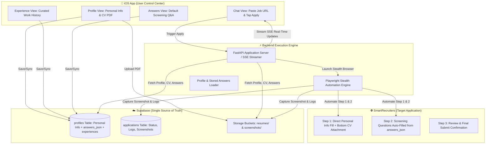

# Plan 3: End-to-End iOS Swift + Playwright SmartRecruiters Architecture

> **Date:** 2026-09-10  
> **Target Platform:** iOS (SwiftUI + Supabase) & Python Backend (Playwright + FastAPI + Supabase)  
> **Core Objective:** "Curate Once in Phone, Auto-Apply Accurately Everywhere" — Eliminating flaky resume parser traps by feeding structured profile, work experience, and screening answers directly into automated job applications.

---

## 1. System Architecture & High-Level Workflow

---

## 2. Detailed Technical Strategy

### A. The "No Easy Apply" Principle
- **The Problem:** The top "Autocomplete with resume" AI parser produces broken, unconfirmed draft experience accordions missing mandatory fields (`Title*`, `Company*`, `To Date*`), triggering validation blocks and Angular DOM detachments.
- **The Solution:** Bypass the top parser completely. Fill all personal inputs programmatically from Supabase and attach the CV PDF directly to the bottom mandatory `Resume *` file input.

### B. "Curate Once in App, Re-use Everywhere"
- **Work Experience**: Users define clean, validated job cards on their phone (`Company`, `Title`, `Start Date`, `End Date`, `Current Role`, `Description`).
- **Screening Q&A Memory**: Standard answers (Notice period, Expected salary, Current salary, Visa status, Nationality, Marital status, Gender, Reason to join, etc.) are saved in `profiles.answers_json`.

---

## 3. Implementation Phases & Component Breakdown

### Phase 1: Supabase Database & Schema Updates

1. **Table: `profiles`**
   - Ensure columns:
     - `first_name` (text), `last_name` (text), `email` (text)
     - `phone_country_code` (text, e.g. `+971`), `phone_number` (text, e.g. `502140290`)
     - `city` (text, e.g. `Abu Dhabi`), `country` (text, e.g. `UAE`)
     - `linkedin_url` (text), `resume_path` (text)
     - `experiences` (JSONB array of work history items)
     - `answers_json` (JSONB object containing default screening answers)
2. **Table: `applications`**
   - `id` (uuid), `user_id` (uuid references auth.users)
   - `job_url` (text), `company_name` (text), `job_title` (text)
   - `status` (text: `pending`, `running`, `step_1_done`, `step_2_done`, `review_ready`, `submitted`, `failed`)
   - `logs` (text array), `screenshot_url` (text), `created_at` (timestamp)

---

### Phase 2: iOS Swift Client Development

1. **Data Models (`Profile.swift`, `Experience.swift`, `ScreeningAnswers.swift`)**:
   - Represent structured work history and screening answers with Codable support.
2. **Profile View Expansion (`ProfileView.swift`, `ProfileViewModel.swift`)**:
   - **Section 1: Personal Info & Contact** (First/Last name, City, Country, Phone code & number, LinkedIn).
   - **Section 2: CV PDF Document** (Single-click document picker with retry/cancel safety).
   - **Section 3: Work Experiences** (List of cards + Add/Edit sheet: Company, Title, From Date, To Date / Present, Bullet points).
   - **Section 4: Default Screening Answers** (Form fields for Nationality, Notice Period, Current Salary, Expected Salary, Visa Status, Marital Status, Gender).
3. **Chat & Automation Trigger View (`ChatView.swift`, `ChatViewModel.swift`)**:
   - Text input to paste job URLs.
   - Interactive stream showing step-by-step progress (e.g. `Bypassing anti-bot...`, `Uploading CV...`, `Filling Step 1...`, `Filling Step 2...`).
   - In-app screenshot preview when application reaches the review/completion state.

---

### Phase 3: Playwright Automation Engine (`backend/`)

1. **Stealth & Anti-Detection Setup**:
   - Non-headless Chromium with `--disable-blink-features=AutomationControlled`.
   - Real macOS desktop User-Agent and realistic viewport settings.
   - Wait strategy using `domcontentloaded` rather than hanging `networkidle`.
2. **Step 1 Automation (Personal Info & Attachment)**:
   - Direct field fills (`#first-name-input`, `#last-name-input`, `#email-input`, `#confirm-email-input`, phone, LinkedIn).
   - City search input + autocomplete dropdown selection (`[role="option"]` / `.c-spl-autocomplete__list-item`).
   - Bottom `Resume *` file input attachment (`input[type="file"]:last`).
   - Click `Next` and await Step 2 DOM mount.
3. **Step 2 Automation (Preliminary Screening Questions)**:
   - Dynamic question matcher that parses label texts and maps them to `answers_json`:
     - **Radios**: `Previous employee` -> `No`, `Relatives` -> `No`.
     - **Text / Numbers**: `Nationality`, `Notice period`, `Earliest start date`, `Current salary`, `Expected salary`.
     - **Select / Comboboxes**: `Current Visa status`, `Marital status`, `Reason to join`, `Gender`.
     - **Textarea**: `Skillset match statement` (1440 chars, filled from profile summary or generated).
     - **Consent Checkbox**: Data privacy agreement checked.
4. **Step 3 Review & Verification**:
   - Take full-page verification screenshot.
   - Upload screenshot to Supabase `screenshots` bucket and link in `applications` table.

---

### Phase 4: Backend API & Service Layer

1. **FastAPI Service (`backend/app/main.py`)**:
   - Endpoint `POST /api/apply` with Server-Sent Events (SSE) streaming logs directly to iOS `ChatView`.
   - Orchestrates profile retrieval, Playwright browser lifecycle, screenshot uploads, and database status updates.
2. **Future Expansion Note**:
   - Dynamic question-answering with LLM / agentic loops will be detailed separately in `plans/plan4-langgraph.md`.

---

## 4. Verification & Testing Checklist

- [ ] **DB Verification**: Supabase `profiles` supports `experiences` and `answers_json`.
- [ ] **Playwright Test Step 1**: Verify direct field fill + bottom CV upload executes in <2s without validation errors.
- [ ] **Playwright Test Step 2**: Verify all 15 screening questions on SmartRecruiters (talabat URL) fill accurately.
- [ ] **iOS UI Verification**: Profile view renders and persists Personal Info, Work History, and Screening Answers.
- [ ] **End-to-End Test**: Paste link in iOS Chat -> Backend executes Playwright -> Stream updates -> Review screenshot appears on phone.
