# Plan 4: Complete LangGraph Flow from MERMAID.md

> **Architecture Reference:** [`docs/MERMAID.md`](file:///Users/alvinrachmat/angraffa/docs/MERMAID.md)  
> **LLM Stack:** LangChain / LangGraph + OpenAI (ChatGPT / `gpt-4o`)  
> **CV Conversion:** `pymupdf4llm` (executed immediately on upload via dedicated endpoint `POST /api/cv/convert-md`)  
> **Placeholders:** `decide_link_platform` & `check_script_in_db` (forced Always No for current phase).

---

## 1. Flow Diagram

```mermaid
flowchart TD
    %% One-Time CV Upload & Conversion (Profile Screen)
    subgraph Profile_Tab ["Profile Screen (One-Time CV Ingestion)"]
        UserUpload["User Uploads PDF CV"] --> UploadStorage["Upload to Supabase Storage ('resumes')"]
        UploadStorage --> CallConvertEndpoint["Call POST /api/cv/convert-md"]
        CallConvertEndpoint --> PyMuPDF["pymupdf4llm converts PDF -> MdCV"]
        PyMuPDF --> SaveMdCV["Save MdCV into DB (profiles.resume_markdown)"]
    end

    %% Main Chat LangGraph Session
    subgraph Chat_Session ["Chat Session (LangGraph StateGraph)"]
        Start(["Start Session"]) --> CheckCV{"Has CV & MdCV in DB?"}
        
        %% No CV Branch
        CheckCV -- "No" --> PromptUpload["Prompt User to Upload CV in Profile Tab"]
        
        %% Yes CV Branch
        CheckCV -- "Yes" --> AskLink["Receive Job Link"]
        AskLink --> DecideLink["Decide Link Platform (Placeholder: Lever/SmartRecruiters)"]
        DecideLink --> HasScript{"Has Script in DB? (Placeholder: Forced Always No)"}
        
        %% Forced No Branch
        HasScript -- "No" --> FetchHTML["Fetch Rendered HTML of Job Page (Playwright)"]
        
        %% LLM 1: Pure Script Synthesis (NO CV data)
        FetchHTML --> LLM_GenScript["LLM 1 (Script Generator): Synthesize General Playwright Script with variable placeholders & Save in DB"]
        
        %% LLM 2: Personalized JSON Mapping
        LLM_GenScript --> LLM_FillJSON["LLM 2 (JSON Mapper): Map MdCV + Profile Answers to Script Variables -> Filled JSON & Save in DB"]
        
        %% Execution
        LLM_FillJSON --> ExecScript["Execute Playwright Script + Filled JSON via importlib"]
        ExecScript --> CheckSuccess{"Succeed? (Max 10x)"}
        
        %% Success / Self-Healing
        CheckSuccess -- "Yes" --> Done(["Done Session (Save Screenshot & Receipt)"])
        CheckSuccess -- "No" --> LogOld["Capture Error Log + Old Script + Failed JSON"]
        LogOld --> LLM_FixScript["LLM 3 (Fixer): Self-Heal Script from Traceback"]
        LLM_FixScript --> LLM_FillJSON
    end
```

---

## 2. Core Implementation Strategy

1. **One-Time `MdCV` Conversion**:
   - `POST /api/cv/convert-md` runs `pymupdf4llm` right after the user picks and uploads their resume in `ProfileView`.
   - The resulting Markdown string is stored directly in `public.profiles (resume_markdown)` column.
2. **Modular Placeholders**:
   - `decide_link_platform`: Identifies the ATS family (SmartRecruiters, Lever, Greenhouse, Workday).
   - `check_script_in_db`: Modular database lookup function, forced to `None` (Always No) for the current phase.
3. **Decoupled Script vs Data Pipeline**:
   - `LLM 1 (Script Synthesizer)`: Generates pure `data["var"]` Playwright code without seeing any user data.
   - `LLM 2 (JSON Mapper)`: Matches `MdCV` + Profile answers into `Filled JSON`.
   - `ExecScript`: Executes `run(page, filled_json)` dynamically with in-memory `importlib` reload.
4. **Self-Healing Loop**:
   - Retries up to 10 times, passing the error traceback, failed script, and failed JSON to `LLM 3 (Fixer)`.
