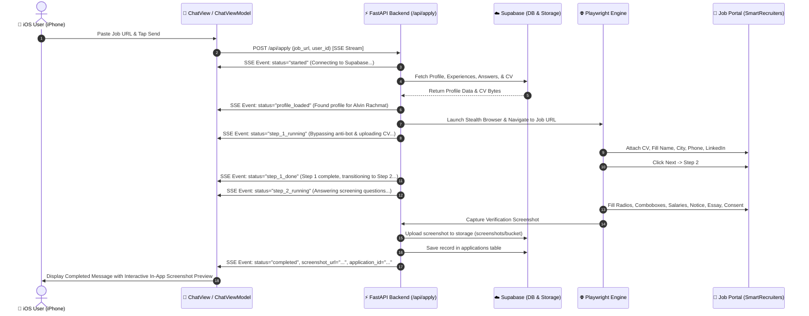

# Plan 5: FastAPI Backend Service & SSE Streaming Architecture

> **Target Platform:** Python FastAPI Backend (`backend/app/`) & iOS Swift Client (`ios/App/`)  
> **Core Objective:** Package the validated Playwright automation engine into a robust, production-ready FastAPI service with Server-Sent Events (SSE) streaming live application logs and review screenshots directly to the iOS `ChatView`.

---

## 1. System Flow & Sequence Diagram



---

## 2. Backend Module Structure (`backend/app/`)

```
backend/
├── app/
│   ├── __init__.py
│   ├── main.py                  # FastAPI app entry point, CORS, health check, router
│   ├── config.py                # Environment settings (.env parser)
│   ├── schemas/
│   │   ├── __init__.py
│   │   └── application.py       # Pydantic models (ApplyRequest, SSEEvent, ApplicationRecord)
│   └── services/
│       ├── __init__.py
│       ├── supabase_service.py  # Supabase client (profile fetch, CV download, screenshot upload)
│       └── runner_service.py    # Playwright runner streaming async generator events
├── testdrive/                   # Research test harness
├── pyproject.toml               # Python dependencies
└── .env                         # Backend environment variables
```

---

## 3. Implementation Steps

### Step 1: Backend Dependencies & Config
- Add `fastapi`, `uvicorn`, `sse-starlette`, `pydantic` to `backend/pyproject.toml`.
- Configure `backend/app/config.py` loading `SUPABASE_URL`, `SUPABASE_KEY`, `HOST`, `PORT`.

### Step 2: Supabase Backend Service (`backend/app/services/supabase_service.py`)
- Fetch profile by user ID or latest profile.
- Download CV PDF bytes from `resumes` bucket.
- Upload captured verification screenshots to `screenshots` bucket with public/signed URLs.
- Insert application record in `public.applications` table (`status`, `job_url`, `screenshot_url`, `logs`).

### Step 3: Playwright Automation Service (`backend/app/services/runner_service.py`)
- Modularize the 100% verified Step 1 & Step 2 form filling logic into an `async def run_smartrecruiter_application(...)` generator.
- Yield real-time event dictionaries:
  - `{"event": "log", "data": {"message": "..."}}`
  - `{"event": "step", "data": {"step": 1, "status": "done"}}`
  - `{"event": "screenshot", "data": {"url": "..."}}`
  - `{"event": "completed", "data": {"status": "success", "application_id": "..."}}`

### Step 4: FastAPI Server & SSE Endpoint (`backend/app/main.py`)
- Implement `POST /api/apply` endpoint returning `EventSourceResponse`.
- Health check `GET /health` returning server status and Playwright readiness.

### Step 5: iOS Client SSE Integration (`ios/App/`)
- Create `BackendAPIService.swift` with `URLSession` async byte streamer parsing SSE events.
- Update `ChatViewModel.swift` to send `ApplyRequest`, stream real-time logs into chat bubble bubbles, and display the screenshot preview when finished.
- Update `ChatMessage.swift` and `ChatView.swift` to render in-app image attachments from `screenshot_url`.

---

## 4. Verification & Testing Checklist

- [ ] FastAPI starts up and responds to `GET /health`.
- [ ] `POST /api/apply` triggers Playwright automation and streams SSE logs live.
- [ ] Screenshot is uploaded to Supabase `screenshots` bucket.
- [ ] iOS `ChatView` connects to `POST /api/apply`, renders live terminal/progress logs, and displays the final verified screenshot card.
